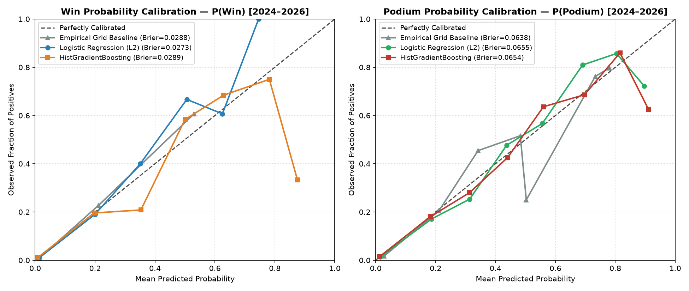
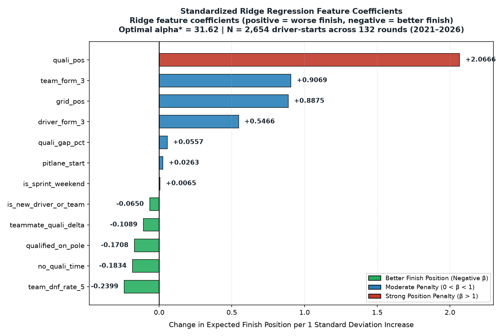
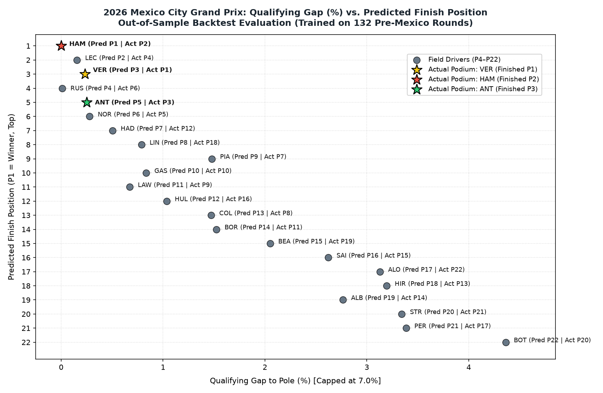
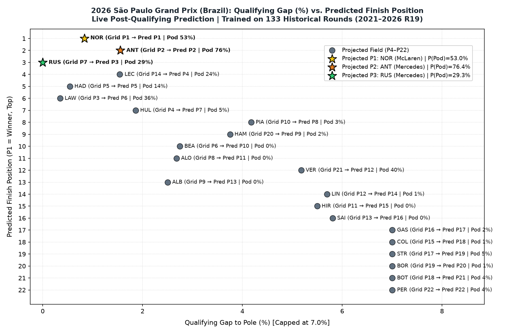

# F1 Race Outcome & Podium Probability Predictor (2021–2026)
### Walk-Forward Machine Learning Evaluation, 2026 Mexico GP Out-of-Sample Backtest & 2026 Brazil GP Live Predictor

---

## 1. Project Overview & Problem Statement

Formula 1 race outcomes are governed by a blend of single-lap qualifying speed, starting grid track position, rolling driver and constructor momentum, and mechanical/racing attrition (DNFs). Standard fan heuristics often rely on raw starting grid position alone—which fails to account for out-of-position frontrunners (grid penalties, wet/mixed qualifying anomalies), constructor race-pace trends, or multi-race reliability rates.

This project implements an end-to-end, zero-leakage Machine Learning pipeline across **133 Formula 1 World Championship rounds (2021 Round 1 through 2026 Round 19 — 2,676 classified driver-starts)** designed to:
1. **Predict Expected Finishing Positions ($\hat{y}$) & Intra-Race Rank Permutations (`1..N`)** using L2-regularized linear models (`RidgeCV` with Leave-One-Out Generalized Cross-Validation).
2. **Generate Calibrated Win (`P(Win)`) and Podium (`P(Podium)`) Probabilities** normalized per race via log-odds shifting so $\sum_{i=1}^{N} P(\text{Win})_i = 1.0$ and $\sum_{i=1}^{N} P(\text{Podium})_i = 3.0$ with strict bounds $p_i \in (0, 1)$.
3. **Validate Strictly via Expanding-Window Walk-Forward Evaluation** across **66 test rounds (2024–2026)** and a **2026 standalone regulatory slice (18 rounds)** against three domain baselines with 1,000-iteration cluster-bootstrapped 95% confidence intervals.
4. **Execute an Out-of-Sample Backtest on the 2026 Mexico City Grand Prix (Round 19, Nov 1, 2026)** trained strictly on the 132 pre-Mexico rounds.
5. **Power a Live Post-Qualifying Predictor for the 2026 São Paulo (Brazil) Grand Prix (Round 20, Nov 8, 2026)** trained on all 133 historical rounds, supporting both pre-weekend power rankings (`--dry-run`) and live post-Qualifying grid penalty overrides (`--grid-overrides`).

---

## 2. Data Pipeline & Anti-Leakage Architecture

### Repository Architecture
```text
F1-Mexico-Predictor/
├── 1_fetch_data.py                      # Stage 1: Rate-limit resilient FastF1 ingestion (atomic checkpoints)
├── run_all.py                           # Stage 8: One-command offline reproducibility runner
├── PROJECT_SPEC.md                      # Stage 0: Formal engineering & methodological specification
├── Engineering_Log.md                   # Complete audit log across Stages 0–8
├── requirements.txt                     # Pinned Python 3.12 dependencies
├── src/
│   ├── 2_clean_data.py                  # Stage 2: DNS removal, team standardization, DNF regex, tie-breaking
│   ├── 3_features.py                    # Stage 3: 12 pre-race features & automated mutation leakage tests
│   ├── 4_evaluate.py                    # Stages 4 & 5: 66-round walk-forward evaluation & probability calibration
│   ├── 5_backtest_mexico.py             # Stage 6: Out-of-sample 2026 Mexico City GP backtest & visualizations
│   └── 6_predict_brazil_live.py         # Stage 7: 2026 São Paulo (Brazil) GP live & dry-run predictor
├── data/
│   ├── raw_all_races_data.csv           # 132 historical rounds raw data (2,674 rows)
│   ├── target_mexico_2026.csv           # 2026 Mexico City GP raw data (22 rows)
│   ├── excluded_dns_rows.csv            # Audit log of 20 excluded DNS/Withdrawn entries
│   ├── clean_races.csv                  # Cleaned historical starters (2,654 rows)
│   ├── clean_target_mexico_2026.csv     # Cleaned Mexico 2026 starters (22 rows)
│   ├── features.csv                     # Engineered pre-Mexico feature matrix (2,654 rows)
│   ├── target_mexico_2026_features.csv  # Engineered Mexico 2026 feature matrix (22 rows)
│   ├── walkforward_predictions_2024_2026.csv # All 1,341 out-of-sample walk-forward predictions
│   ├── evaluation_summary.csv           # Walk-forward evaluation metrics & bootstrap CIs
│   └── mexico_2026_backtest_results.csv # Complete 22-driver Mexico 2026 backtest table
└── outputs/
    ├── calibration_plot.png             # 2-panel P(Win) & P(Podium) reliability diagram
    ├── feature_coefficients.png         # Standardized RidgeCV feature importance chart
    └── mexico_2026_quali_vs_predicted.png # Mexico 2026 Qualifying Gap vs. Predicted Rank scatter
```

### Feature Engineering & Zero-Leakage Guarantees (`src/3_features.py`)
All 12 model features are strictly known **prior to lights out on Sunday**:
1. `grid_pos`: Starting grid slot normalized strictly to unique integers `[1, N_starters]` per race.
2. `quali_pos`: Qualifying classification normalized strictly to unique integers `[1, N_starters]` per race (ties broken deterministically via `best_quali_sec`).
3. `qualified_on_pole`: Binary indicator (`1` if `quali_pos == 1`, else `0`).
4. `pitlane_start`: Binary indicator (`1` if raw `GridPosition == 0`, moved to back of grid).
5. `no_quali_time`: Binary indicator (`1` if driver failed to record a valid Q1/Q2/Q3 lap time).
6. `is_sprint_weekend`: Binary indicator (`1` if `EventFormat` is Sprint/Sprint Shootout/Sprint Qualifying).
7. `quali_gap_pct`: Percentage lap-time deficit to pole position:
   $$\text{quali\_gap\_pct}_i = \min\left(7.0,\; \frac{t_{\text{best},i} - t_{\text{pole}}}{t_{\text{pole}}} \times 100\right)$$
   Capped at `7.0%` (matching the FIA 107% rule; 89/2,676 observations = `3.33%` capped/imputed).
8. `teammate_quali_delta`: Intra-team qualifying pace differential (`quali_gap_pct` minus team mean `quali_gap_pct` in that round).
9. `driver_form_3`: Driver's lagged 3-race rolling mean finish position (`shift(1).rolling(3, min_periods=1).mean()`).
10. `team_form_3`: **Anti-Leakage Constructor Form**—computed by first aggregating both teammates' `FinishPosition` to a single `(Year, Round, TeamName)` mean per race, then applying `.shift(1).rolling(3, min_periods=1).mean()`. Grouping directly on driver rows without race-level aggregation would leak a teammate's same-day race finish into the other driver's pre-race feature!
11. `team_dnf_rate_5`: Constructor-level lagged 5-race rolling DNF rate (`shift(1).rolling(5, min_periods=1).mean()`).
12. `is_new_driver_or_team`: Binary indicator for rookie/debut entries receiving neutral prior imputation (`10.5` for $\le 2025$, `11.5` for $2026$).

**Automated Mutation Leakage Verification:** Every run of `src/3_features.py` executes three mutation tests that corrupt `FinishPosition = 999.0` and `is_dnf = 1` across future and current target rounds and assert via `np.allclose(..., atol=1e-9)` that all prior and current pre-race feature matrices remain 100% invariant.

---

## 3. Walk-Forward Validation Methodology & Results (`src/4_evaluate.py`)

For every test round $t$ from **2024 Round 1 through 2026 Round 18 (66 test rounds, 1,341 driver-starts)**, models are trained strictly on historical rounds $< t$. Standard errors and 95% confidence intervals for $\Delta\text{MAE} = \text{MAE}_{\text{Model}} - \text{MAE}_{\text{Grid}}$ are computed via **1,000-iteration cluster bootstrap resampling by `(Year, Round)`**.

### A. Position Prediction Benchmark: 2024–2026 Overall (66 Test Rounds, 1,341 Starts)
| Model | N_Races | MAE | $\Delta$MAE vs. Grid | 95% Bootstrap CI | Spearman $\rho$ | Top-3 Hit % | Winner Hit % |
|---|:---:|:---:|:---:|:---:|:---:|:---:|:---:|
| Baseline 1: Starting Grid (`grid_pos`) | 66 | 3.1299 | 0.0000 | `[+0.0000, +0.0000]` | 0.6883 | 68.69% | 60.61% |
| Baseline 2: Qualifying Rank (`quali_pos`) | 66 | 3.0697 | -0.0602 | `[-0.1205, +0.0027]` | 0.7049 | 66.67% | 62.12% |
| Baseline 3: Heuristic [`grid + team_form_3`] (Cont.) | 66 | 3.1445 | +0.0146 | `[-0.0979, +0.1292]` | 0.6923 | 64.65% | 50.00% |
| Baseline 3: Heuristic [`grid + team_form_3`] (Rank) | 66 | 3.1586 | +0.0287 | `[-0.0788, +0.1384]` | 0.6923 | 64.65% | 50.00% |
| Full `RidgeCV` (Continuous $\hat{y}$) | 66 | 3.0863 | -0.0435 | `[-0.1534, +0.0750]` | **0.7105** | **69.19%** | 57.58% |
| **Full `RidgeCV` (Intra-Race Rank-Ordered)** | **66** | **3.0359** | **-0.0939** | **`[-0.2022, +0.0135]`** | **0.7105** | **69.19%** | 57.58% |

### B. Position Prediction Benchmark: 2026 Season Standalone (18 Test Rounds, 389 Starts)
| Model | N_Races | MAE | $\Delta$MAE vs. Grid | 95% Bootstrap CI | Spearman $\rho$ | Top-3 Hit % | Winner Hit % |
|---|:---:|:---:|:---:|:---:|:---:|:---:|:---:|
| Baseline 1: Starting Grid (`grid_pos`) | 18 | 3.2049 | 0.0000 | `[+0.0000, +0.0000]` | 0.6832 | 62.96% | 72.22% |
| Baseline 2: Qualifying Rank (`quali_pos`) | 18 | 3.0635 | -0.1414 | `[-0.2727, -0.0303]` | 0.7185 | 61.11% | 72.22% |
| Baseline 3: Heuristic [`grid + team_form_3`] (Cont.) | 18 | 3.2797 | +0.0748 | `[-0.1002, +0.2555]` | 0.7002 | 59.26% | 61.11% |
| Baseline 3: Heuristic [`grid + team_form_3`] (Rank) | 18 | 3.1780 | -0.0269 | `[-0.1628, +0.1105]` | 0.7002 | 59.26% | 61.11% |
| Full `RidgeCV` (Continuous $\hat{y}$) | 18 | 3.1717 | -0.0333 | `[-0.2277, +0.1719]` | 0.7129 | **64.81%** | **72.22%** |
| **Full `RidgeCV` (Intra-Race Rank-Ordered)** | **18** | **3.1035** | **-0.1015** | **`[-0.3051, +0.0916]`** | 0.7129 | **64.81%** | **72.22%** |

> **Why Intra-Race Rank-Ordering (`rank(yhat)`) Beats Continuous $\hat{y}$:**  
> Because ~14% of starters suffer a DNF (classified at positions 16–22), conditional expectation regression $E[\text{FinishPosition}|X]$ shrinks predictions toward the mid-field mean (~10.57)—so even a dominant pole-sitter is predicted around `2.7`, and backmarkers around `18.5`. Mapping $\hat{y}$ to a valid intra-race permutation $\{1, 2, \dots, N\}$ eliminates mean-shrinkage bias and lowers walk-forward MAE from `3.0863` to **`3.0359`** ($\Delta\text{MAE} = -0.0939$ vs. Starting Grid).

### C. Calibrated Win (`P(Win)`) & Podium (`P(Podium)`) Probabilities
| Slice | Target | Empirical Grid Baseline (Brier / LogLoss) | Logistic Regression (Brier / LogLoss) | HistGradientBoosting (Brier / LogLoss) | Best Model (by Brier) |
|---|:---:|:---:|:---:|:---:|---|
| **2024–2026 (66 Rnds)** | `P(Win)` | `0.02883` / `0.10620` | **`0.02729`** / **`0.09478`** | `0.02892` / `0.09628` | **Logistic Regression** |
| **2024–2026 (66 Rnds)** | `P(Podium)` | **`0.06384`** / `0.21495` | `0.06548` / `0.21765` | `0.06538` / **`0.21001`** | **Empirical Grid (Brier) / HGB (LogLoss)** |
| **2026 Only (18 Rnds)** | `P(Win)` | `0.02196` / `0.08676` | `0.02069` / `0.07644` | **`0.01792`** / **`0.06079`** | **HistGradientBoosting** |
| **2026 Only (18 Rnds)** | `P(Podium)` | **`0.06326`** / `0.20422` | `0.06534` / `0.20075` | `0.06361` / **`0.19577`** | **Empirical Grid (Brier) / HGB (LogLoss)** |



---

## 4. 2026 Mexico City Grand Prix Out-of-Sample Backtest (`src/5_backtest_mexico.py`)

Trained strictly on the **132 pre-Mexico rounds (2,654 rows)**, the pipeline generated out-of-sample predictions for the **2026 Mexico City Grand Prix (Round 19, held Nov 1, 2026)**:

- **Actual Race Podium:** **P1:** `VER` (Red Bull, Grid P5) | **P2:** `HAM` (Ferrari, Grid P1) | **P3:** `ANT` (Mercedes, Grid P4).
- **Top-3 Capture: 2/3 in Top-3 (`HAM`, `VER`) and 3/3 (100% of actual podium: `VER`, `HAM`, `ANT`) captured in Model Top-5!**
  - Specifically, the model ranked `HAM` P1 (`2.76`), `LEC` P2 (`4.34`), `VER` P3 (`5.29`, jumping from Grid P5 into the predicted Top-3 with `57.3%` podium probability), `RUS` P4 (`5.80`), and `ANT` P5 (`5.92`, with `33.1%` LR / `30.3%` HGB podium probability).

### Mexico 2026 Model Comparison Table
| Model | MAE All Starters ($N=22$) | MAE Classified Finishers ($N=17$) | Spearman $\rho$ | Top-3 Hits (/3) | Winner Hit |
|---|:---:|:---:|:---:|:---:|:---:|
| Baseline 1: Starting Grid (`grid_pos`) | 3.636 | 3.353 | 0.719 | 1 / 3 (33.3%) | No (`HAM`) |
| Baseline 2: Qualifying Rank (`quali_pos`) | 3.182 | 2.941 | 0.817 | 1 / 3 (33.3%) | No (`HAM`) |
| Baseline 3: Heuristic (Continuous) | 3.297 | 2.672 | 0.741 | 1 / 3 (33.3%) | No (`HAM`) |
| Baseline 3: Heuristic (Rank-Ordered) | 3.727 | 3.353 | 0.741 | 1 / 3 (33.3%) | No (`HAM`) |
| **Full `RidgeCV` (Continuous $\hat{y}$)** | **2.917** | **2.287** | **0.823** | **2 / 3 (66.7%)** | No (`HAM`) |
| **Full `RidgeCV` (Intra-Race Rank-Ordered)** | **3.091** | **2.706** | **0.823** | **2 / 3 (66.7%)** | No (`HAM`) |

- **Pace vs. Random Attrition ($N=17$ Finishers vs. $N=22$ All Starters):** Five drivers (`LIN`, `BEA`, `BOT`, `STR`, `ALO`) suffered mechanical/racing retirements in Mexico. Across the 17 classified finishers, `RidgeCV` achieved an MAE of **`2.287` positions** (improving over Starting Grid by **$-1.066$ positions**), and across all 22 starters achieved **`2.917`** (improving over Starting Grid by **$-0.719$ positions**) with Spearman $\rho = \mathbf{0.823}$.





---

## 5. 2026 São Paulo (Brazil) Grand Prix Live Prediction Pipeline (`src/6_predict_brazil_live.py`)

By combining `data/clean_races.csv` (132 rounds) and `data/clean_target_mexico_2026.csv` (Round 19), the Brazil pipeline trains on all **133 historical rounds (2,676 driver-starts)** and computes the latest lagged rolling form entering **Round 20 (São Paulo Grand Prix, Nov 8, 2026)**.

### Official Live Post-Qualifying Predictions (Saturday Classification + FIA Grid Penalties)
*(Generated live using actual Saturday qualifying classifications and confirmed grid penalties: `data/brazil_2026_actual_quali.csv`)*

| Rank | Driver | Team | Grid | Quali | Q_Gap% | `driver_form_3` | `team_form_3` | `team_dnf_rate_5` | Exp. Pos ($\hat{y}$) | $P(\text{Win})_{\text{LR}}$ | $P(\text{Win})_{\text{HGB}}$ | $P(\text{Pod})_{\text{HGB}}$ | $P(\text{Pod})_{\text{LR}}$ |
|:---:|:---:|---|:---:|:---:|:---:|:---:|:---:|:---:|:---:|:---:|:---:|:---:|:---:|
| **1** | **NOR** | McLaren | P1 | P1 | 0.84% | 4.67 | 5.50 | 10% | **3.51** | **66.6%** | **33.7%** | **53.0%** | **85.8%** |
| **2** | **ANT** | Mercedes | P2 | P3 | 1.56% | **2.33** | 5.00 | 10% | **4.41** | **10.1%** | **10.0%** | **76.4%** | **72.4%** |
| **3** | **RUS** | Mercedes | P7 | P2 | **0.00%** | 7.67 | 5.00 | 10% | **5.63** | **8.2%** | **12.9%** | **29.3%** | **48.9%** |
| **4** | **LEC** | Ferrari | P14 | P4 | 1.54% | 2.67 | **3.33** | 0% | **6.72** | 6.1% | 27.9% | 23.6% | 27.6% |
| **5** | **HAD** | Red Bull | P5 | P7 | 0.55% | 9.33 | 5.50 | 0% | **7.89** | 2.2% | 1.3% | 13.9% | 18.1% |
| **6** | **LAW** | RB | P3 | P5 | 0.35% | 8.33 | 11.67 | 10% | **7.94** | 5.4% | 5.4% | 35.7% | 21.6% |
| **7** | **HUL** | Sauber_Audi | P4 | P6 | 1.86% | 11.67 | 13.50 | 10% | **9.28** | 1.0% | 2.1% | 4.6% | 10.3% |
| **8** | **PIA** | McLaren | P10 | P12 | 4.18% | 6.33 | 5.50 | 10% | **9.37** | 0.1% | 0.1% | 2.5% | 5.2% |
| **9** | **HAM** | Ferrari | P20 | P11 | 3.75% | 4.00 | **3.33** | 0% | **10.02** | 0.1% | 0.3% | 2.4% | 2.6% |
| **10** | **BEA** | Haas | P6 | P8 | 2.75% | 17.67 | 15.50 | 20% | **11.11** | 0.1% | 0.8% | 0.1% | 2.7% |
| **11** | **ALO** | Aston Martin | P8 | P9 | 2.68% | 18.00 | 18.33 | 50% | **11.96** | 0.1% | 1.4% | 0.1% | 1.3% |
| **12** | **VER** | Red Bull | P21 | P16 | 5.18% | **1.67** | 5.50 | 0% | **12.01** | 0.0% | 0.5% | 40.2% | 0.6% |
| **13** | **ALB** | Williams | P9 | P10 | 2.51% | 16.33 | 16.00 | 30% | **12.06** | 0.1% | 1.4% | 0.1% | 1.1% |
| **14** | **LIN** | RB | P12 | P14 | 5.70% | 15.00 | 11.67 | 10% | **12.66** | 0.0% | 0.2% | 1.0% | 0.6% |
| **15** | **HIR** | Haas | P11 | P13 | 5.50% | 13.00 | 15.50 | 20% | **12.75** | 0.0% | 0.2% | 0.2% | 0.7% |
| **16** | **SAI** | Williams | P13 | P15 | 5.81% | 15.67 | 16.00 | 30% | **13.97** | 0.0% | 0.1% | 0.3% | 0.2% |
| **17** | **GAS** | Alpine | P16 | P18 | 7.00% | 10.33 | 13.50 | 40% | **14.42** | 0.0% | 0.6% | 1.5% | 0.1% |
| **18** | **COL** | Alpine | P15 | P17 | 7.00% | 16.67 | 13.50 | 40% | **14.68** | 0.0% | 0.2% | 1.5% | 0.1% |
| **19** | **STR** | Aston Martin | P17 | P19 | 7.00% | 18.67 | 18.33 | 50% | **16.44** | 0.0% | 0.1% | 5.3% | 0.0% |
| **20** | **BOR** | Sauber_Audi | P19 | P22 | 7.00% | 15.33 | 13.50 | 10% | **17.08** | 0.0% | 0.1% | 0.8% | 0.0% |
| **21** | **BOT** | Cadillac | P18 | P20 | 7.00% | 19.67 | 18.67 | 40% | **17.68** | 0.0% | 0.2% | 3.8% | 0.0% |
| **22** | **PER** | Cadillac | P22 | P21 | 7.00% | 17.67 | 18.67 | 40% | **18.39** | 0.0% | 0.2% | 3.8% | 0.0% |



### Pre-Weekend Form & Power Rankings Entering Brazil 2026 (Historical Simulation `--dry-run`)
*(Evaluated prior to Saturday qualifying using each driver's rolling 3-race qualifying baseline across Rounds 17–19)*

| Rank | Driver | Team | Baseline Grid | Baseline Q_Gap% | `driver_form_3` | `team_form_3` | `team_dnf_rate_5` | Exp. Pos ($\hat{y}$) | $P(\text{Win})_{\text{LR}}$ | $P(\text{Win})_{\text{HGB}}$ | $P(\text{Pod})_{\text{HGB}}$ | $P(\text{Pod})_{\text{LR}}$ |
|:---:|:---:|---|:---:|:---:|:---:|:---:|:---:|:---:|:---:|:---:|:---:|:---:|
| **1** | **VER** | Red Bull | P1 | 0.00% | **1.67** | 5.50 | 0% | **3.24** | **56.7%** | **47.7%** | **87.1%** | **79.1%** |
| **2** | **LEC** | Ferrari | P2 | 0.00% | 2.67 | **3.33** | 0% | **3.99** | 15.6% | 18.4% | **69.3%** | **64.2%** |
| **3** | **HAM** | Ferrari | P3 | 0.01% | 4.00 | **3.33** | 0% | **4.66** | 9.2% | 12.6% | 43.1% | **51.4%** |
| **4** | **ANT** | Mercedes | P4 | 0.02% | 2.33 | 5.00 | 10% | **5.14** | 10.4% | 18.8% | **56.5%** | 41.4% |
| **5** | **RUS** | Mercedes | P5 | 0.11% | 7.67 | 5.00 | 10% | **6.28** | 2.4% | 0.8% | 20.9% | 22.8% |
| **6** | **NOR** | McLaren | P6 | 0.27% | 4.67 | 5.50 | 10% | **6.59** | 3.5% | 1.1% | 9.0% | 19.1% |
| **7** | **PIA** | McLaren | P7 | 0.81% | 6.33 | 5.50 | 10% | **7.23** | 1.2% | 0.0% | 11.0% | 12.4% |
| **8** | **LAW** | RB | P8 | 0.80% | 8.33 | 11.67 | 10% | **9.36** | 0.5% | 0.2% | 0.6% | 3.6% |
| **9** | **HAD** | Red Bull | P11 | 2.45% | 9.33 | 5.50 | 0% | **9.73** | 0.1% | 0.0% | 0.7% | 2.1% |
| **10** | **GAS** | Alpine | P9 | 0.83% | 10.33 | 13.50 | 40% | **9.99** | 0.3% | 0.1% | 0.3% | 1.9% |

---

## 6. Documented Scope Constraints & Analytical Assumptions

1. **FastF1 API Rate-Limit Constraint (`500 calls/hr`):**
   - Extracting full lap-by-lap telemetry (`laps=True`, `telemetry=True`) and practice sessions (`FP1`, `FP2`, `FP3`) across 133 rounds exceeds the Jolpica/Ergast 500 calls/hour limit. We intentionally scoped data extraction strictly to official Qualifying (`Q`) and Race (`R`) result tables (`laps=False, telemetry=False, weather=False, messages=False`). Consequently, long-run FP2 tire degradation, speed-trap telemetry, and circuit altitude are documented out-of-scope constraints.
2. **Constructor Lineage Standardization:**
   - Rebranded constructors sharing chassis/factory lineage are mapped to unified identifiers (`AlphaTauri` / `RB F1 Team` / `Racing Bulls` $\to$ `RB`; `Alfa Romeo` / `Kick Sauber` / `Audi` $\to$ `Sauber_Audi`; `Alpine F1 Team` $\to$ `Alpine`), while preserving raw names in `RawTeamName`. In 2026, `Cadillac` enters as the 11th constructor (22-car grid).
3. **DNF Classification Rule:**
   - Any classified status matching `Finished`, `Lapped`, or regex `^\+\d+\s+Laps?$` is encoded as `is_dnf = 0` (classified finisher); all other statuses (`Retired`, `Collision`, `Engine`, `Brakes`, `Disqualified`, etc.) are encoded as `is_dnf = 1`. Did Not Start (`DNS` / `Withdrawn`) entries (20 rows across 2021–2026) are excluded prior to modeling and logged in `data/excluded_dns_rows.csv`.
4. **Spa 2021 Anomaly Ablation:**
   - Walk-forward ablation confirmed that retaining the rain-shortened 2021 Belgian GP (`is_anomaly_race = 1`) slightly improved out-of-sample Rank MAE (`3.0359` vs `3.0374` when excluded); thus all 132 historical rounds are retained.

---

## 7. Quickstart & Reproducibility Guide

### 1. Environment Setup
```bash
python -m venv .venv
# Windows PowerShell:
.\.venv\Scripts\Activate.ps1
pip install -r requirements.txt
```

### 2. Run the Entire Offline Pipeline in One Command (`Stage 2 -> Stage 7 Dry-Run`)
```bash
python run_all.py
```
This sequentially runs `src/2_clean_data.py`, `src/3_features.py` (with automated leakage tests), `src/4_evaluate.py`, `src/5_backtest_mexico.py`, and `src/6_predict_brazil_live.py --dry-run` in ~15 seconds.

### 3. Live 2026 São Paulo (Brazil) GP Predictions (After Qualifying on Nov 7, 2026)
```bash
# Standard live run (fetches 2026 Round 20 Qualifying from FastF1 and writes data/brazil_2026_live_predictions.csv):
python src/6_predict_brazil_live.py

# If FIA stewards apply post-Qualifying starting grid penalties (e.g., VER drops to P10, LAW starts P22):
python src/6_predict_brazil_live.py --grid-overrides "VER:10,LAW:22"
```

### 4. Re-Fetching Raw Data from FastF1 (Optional)
```bash
python 1_fetch_data.py --auto-wait
```
